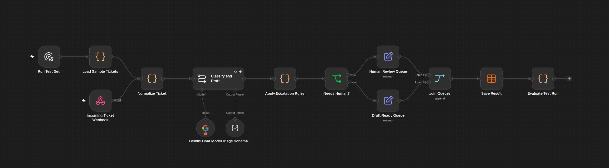
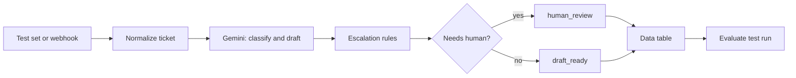

# AI Ticket Triage (n8n + LLM)

An n8n workflow that classifies support tickets by category and priority, drafts a reply and sends risky or unclear cases to a human.

The product (TradeSim Desk) and all tickets are fictional. No real customer data is used.



## How it works



Nothing is sent to customers. Both queues are rows in an n8n data table.

**Categories:** billing, bug, license_activation, how_to, feature_request, other

**Priorities:** critical, high, normal, low

**A ticket goes to a human when any of these is true:**

- the model output does not match the schema
- model confidence is below 0.8
- priority is critical
- a payment has to be checked or returned
- security, privacy or legal topic
- the ticket is unclear or has several unrelated issues
- the text tries to give the model instructions
- a how-to question is not covered by the knowledge base
- a sensitive keyword is found (refund, chargeback, hacked, gdpr and so on). This check does not depend on the model

## Results

30 sample tickets with labels set in advance, model `gemini-3-flash-preview`, temperature 0.1.

| Metric | First working run | Final run |
|---|---|---|
| Category correct | 29 / 30 | 30 / 30 |
| Priority correct | 24 / 30 | 23 / 30 |
| Escalations caught | 10 / 10 | 10 / 10 |
| Unnecessary escalations | 0 | 0 |
| Invalid model outputs | 1 | 0 |

Between the two runs:

- The prompt injection ticket (T28) returned a cut off answer (`MAX_TOKENS`). The fallback rule still sent it to a human. The output token limit was raised from 2048 to 8192.
- Some drafts claimed actions that never happened ("I have passed this to the development team"). The prompt now forbids this.

Per ticket results of the final run: [results/final_run.csv](results/final_run.csv)

## What I learned and limitations

- **Self-reported confidence did not work.** In the final run the model gave 1.0 for 29 tickets and 0.9 for one, so the 0.8 threshold never fired. All escalations came from the flags and rules.
- **Priority is the weakest part** (23 / 30). Most misses are between low and normal, where the definitions overlap.
- **The numbers are optimistic.** The tickets, labels and prompt were prepared together, the set is small, and the prompt was changed after the first run on the same set.
- **Results vary between runs**, even at low temperature.
- **Draft quality is not measured.** Drafts need a human check before sending.
- The model is a preview version and may change.

Next steps: a separate holdout set, a better uncertainty signal (for example, agreement between two runs), clearer priority definitions.

## Run it yourself

1. Import `workflow.json` into n8n.
2. Create a data table `ticket_triage_results` with columns: `run_id`, `ticket_id`, `subject`, `category`, `priority`, `confidence` (number), `escalated` (boolean), `escalation_reasons`, `draft_reply`, `expected_category`, `expected_priority`, `expected_escalate`, `queue`. Other columns are strings.
3. Select this table in the **Save Result** node.
4. The export contains no credentials. Create your own Gemini API key in Google AI Studio and add it as a Google Gemini credential to the **Gemini Chat Model** node.
5. Run the workflow with the **Run Test Set** trigger.

The full test run sends 30 requests in a short time and may hit the rate limits of a free tier key. A failed request shows up as `invalid_model_output`. In that case lower the batch size or increase the delay in the batch settings of **Classify and Draft**.

A single ticket can be sent to the webhook:

```json
{ "subject": "Dark theme", "body": "Where do I switch on the dark theme?" }
```

The webhook has no authentication. Add it before publishing the workflow.

## Files

- `workflow.json` - n8n workflow export
- `data/sample_tickets.json` - test tickets with expected labels
- `results/final_run.csv` - results of the final run
